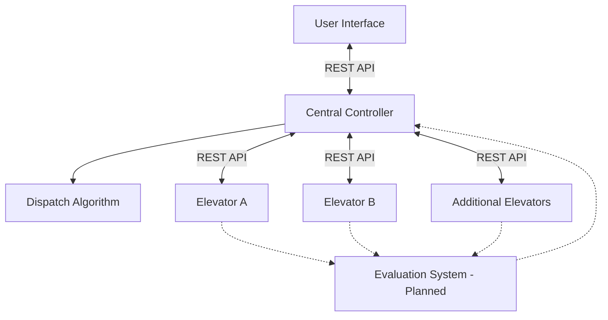

# Smart Elevators — NEXUS


## Project Overview

Smart Elevators NEXUS is a destination dispatch elevator management system developed as a team project for the

Programming II course at the Athens University of

Economics and Business (AUEB).

Department of Management Science and Technology (DMST).

Academic Year: 2026–2027.

The goal of the project is to develop a centralized elevator management system that assigns passengers to suitable elevators based on their requested destinations.

## System Architecture

The system consists of four main components:



### Central Controller

- Receives passenger requests.

- Validates building configuration and requested floors.

- Communicates with elevator controllers through REST.

- Selects an available elevator.

- Sends movement commands to the assigned elevator.

### Dispatch Algorithm

- Implements a nearest-elevator assignment strategy.

- Takes elevator availability into consideration.

- Maintains elevator floor information.

- Supports buildings with configurable numbers of

  elevators and floors.

### Elevator Controller

- Represents an individual elevator.

- Maintains elevator position and status.

- Receives movement commands through REST.

- Provides elevator status information.

- Validates elevator identifiers and floor limits.

### User Interface

- Command-line interface for passengers.

- Configurable installation floor.

- Accepts destination floor requests.

- Communicates with the Central Controller.

- Displays the assigned elevator identifier.

- Handles invalid input.

### Evaluation System

Planned component responsible for evaluating the performance of the elevator management system through traffic scenarios, performance metrics and automated evaluation.

## System Specifications

| Parameter | Supported configuration |
|---|---|
| Elevators | 2–20 |
| Floors | 3–200 |
| Elevator identifiers | A–T |
| Floor numbering | 1–200 |
| Communication | REST API |
| User Interface | CLI |
| Central Controller port | 8080 |
| Elevator ports | 8081 onwards |

## Technologies and Tools

- Java 17

- Apache Maven

- Java HTTP Server

- Java HTTP Client

- REST API

- JUnit 5

- Git

- GitHub

## Getting Started

### Prerequisites

Make sure the following tools are installed:

- Java Development Kit 17

- Apache Maven

- Git

Verify the installation:

```bash
java -version
mvn -version
git --version
```

### Clone the repository

```bash
git clone https://github.com/PeriklhsOrfanos/smart-elevators-NEXUS.git
cd smart-elevators-NEXUS
git switch main
```

### Build the project

```bash
mvn clean package
```

## How to Run

The following example demonstrates a building with two elevators and ten floors.

Open a separate terminal for each component.

All terminals must be opened in the project directory.

### Terminal 1 — Central Controller

```bash
java -cp target/classes gr.aueb.dmst.elevators.central.CentralController 2 10
```

Parameters:

- 2: Number of elevators.

- 10: Number of building floors.

### Terminal 2 — Elevator A

```bash
java -cp target/classes gr.aueb.dmst.elevators.elevator.ElevatorController A 1 10 8081
```

### Terminal 3 — Elevator B

```bash
java -cp target/classes gr.aueb.dmst.elevators.elevator.ElevatorController B 5 10 8082
```

Elevator Controller parameters:

- Elevator identifier.

- Initial floor.

- Number of building floors.

- Server port.

### Terminal 4 — User Interface

```bash
java -cp target/classes gr.aueb.dmst.elevators.ui.UserInterface --floor=1 --server=http://localhost:8080
```

Enter a valid destination floor between 2 and 10.

The User Interface displays the assigned elevator.

Type `exit` to close the User Interface.

Use `Ctrl+C` to stop the controller processes.

## REST API

### Central Controller

| Endpoint | Purpose |
|---|---|
| /api/health | Controller health information |
| /api/requests | Passenger destination requests |

### Elevator Controller

| Endpoint | Purpose |
|---|---|
| /api/elevator/status | Elevator status information |
| /api/elevator/move | Elevator movement commands |

## Testing

Run all automated tests:

```bash
mvn clean test
```

### Test classes

- DispatchAlgorithmTest

- ElevatorControllerTest

- NexusIntegrationTest

### Integration branch test results

The integrated version was tested on November 27, 2026.

| Metric | Result |
|---|---:|
| Total tests | 14 |
| Passed | 14 |
| Failures | 0 |
| Errors | 0 |
| Skipped | 0 |
| Integration tests passed | 4 |

Build result: **SUCCESS**

## Repository Structure

```text
smart-elevators-NEXUS/
├── docs/
│   ├── ai-usage/
│   ├── metrics/
│   ├── presentations/
│   └── uml/
├── scripts/
├── src/
│   ├── main/
│   │   └── java/gr/aueb/dmst/elevators/
│   │       ├── central/
│   │       ├── elevator/
│   │       ├── evaluation/
│   │       ├── model/
│   │       └── ui/
│   └── test/
│       └── java/gr/aueb/dmst/elevators/
│           ├── central/
│           ├── elevator/
│           └── integration/
├── .gitignore
├── LICENSE
├── pom.xml
└── README.md
```

## Team Contributions

The project is developed collaboratively by the NEXUS team.

The original implementations and their subsequent integration are documented in the following pull requests:

| Contribution | Pull Request |
|---|---|
| Initial Central Controller | [#2](https://github.com/PeriklhsOrfanos/smart-elevators-NEXUS/pull/2) |
| Initial User Interface | [#3](https://github.com/PeriklhsOrfanos/smart-elevators-NEXUS/pull/3) |
| Initial Elevator implementation | [#4](https://github.com/PeriklhsOrfanos/smart-elevators-NEXUS/pull/4) |
| System Integration | [#5](https://github.com/PeriklhsOrfanos/smart-elevators-NEXUS/pull/5) |

These pull requests document the original development work and the integration process.

## Project Status

- [x] Initial project structure

- [x] Maven configuration

- [x] Central Controller

- [x] Dispatch Algorithm

- [x] Elevator Controller

- [x] Command-line User Interface

- [x] REST communication

- [x] Unit tests

- [x] Integration tests

- [x] Integration of the three main components

- [ ] Evaluation protocol

- [ ] Evaluation System integration

- [ ] Performance evaluation

- [ ] Interoperability testing

- [ ] Continuous Integration

- [ ] Final technical report

- [ ] Promotional video

## Project Roadmap

| Date | Milestone |
|---|---|
| 04/11/2026 | Project idea and interfaces |
| 25/11/2026 | Design and initial implementation |
| 02/12/2026 | Evaluation protocol presentation |
| 09/12/2026 | Second progress presentation |
| 13/01/2027 | Final presentation and evaluation |

## AI Usage

Generative AI tools have been used during the design, development, testing and documentation of the project.

AI-assisted development is documented in accordance with the course requirements.

Documentation is available in:

[AI Usage Documentation](docs/ai-usage/)

The team is responsible for reviewing, understanding, testing and validating all AI-generated contributions.

## License

This project is distributed under the MIT License.

See the [LICENSE](LICENSE) file for more information.
